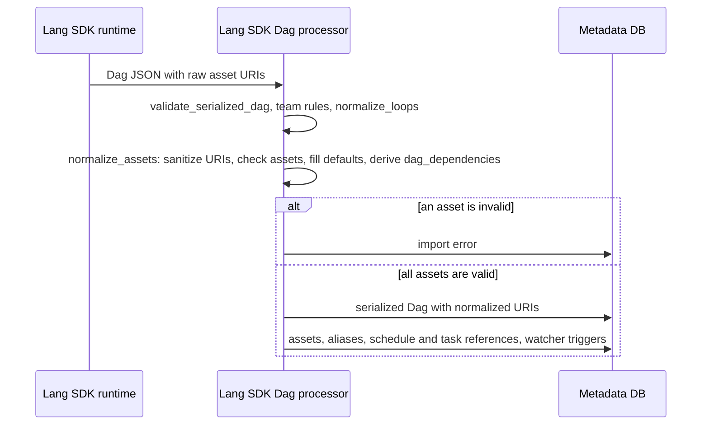
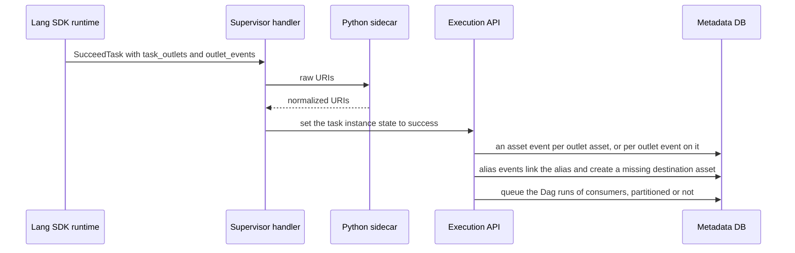
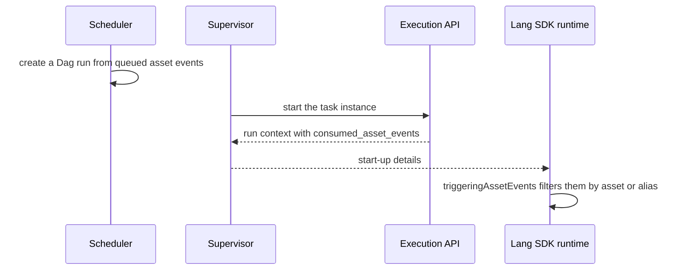
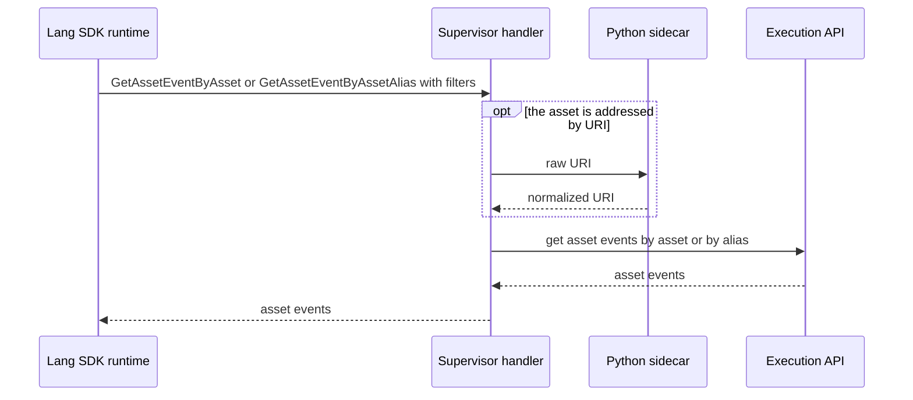
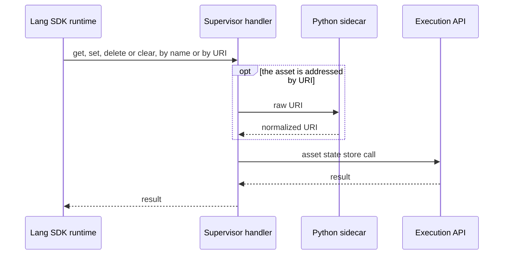

<!--
 Licensed to the Apache Software Foundation (ASF) under one
 or more contributor license agreements.  See the NOTICE file
 distributed with this work for additional information
 regarding copyright ownership.  The ASF licenses this file
 to you under the Apache License, Version 2.0 (the
 "License"); you may not use this file except in compliance
 with the License.  You may obtain a copy of the License at

   http://www.apache.org/licenses/LICENSE-2.0

 Unless required by applicable law or agreed to in writing,
 software distributed under the License is distributed on an
 "AS IS" BASIS, WITHOUT WARRANTIES OR CONDITIONS OF ANY
 KIND, either express or implied.  See the License for the
 specific language governing permissions and limitations
 under the License.
 -->

# ADR-0019: Assets and Timetables Across Lang SDKs

## Status

Proposed.

## Context

A Lang SDK Dag cannot use assets: it cannot define one, schedule on one, declare inlets or outlets,
or read and emit asset events. Its `schedule` takes only a cron expression or a preset. The runtimes
send `task_outlets: []` and `outlet_events: []` on success, so even a stub TaskHandler behind a
Python `@task.stub` with outlets records no asset event.

This ADR fixes the contract every SDK shares. Each SDK records its own spelling in its own ADR:
[TypeScript](../../../ts-sdk/adr/0004-assets-and-timetables-authoring-interface.md),
[Go](../../../go-sdk/adr/0010-assets-and-timetables-authoring-interface.md) and
[Java](../../../java-sdk/adr/0004-assets-and-timetables-authoring-interface.md).

## Decision

1. **No new serialized format.** Assets, refs, aliases and `all`/`any` conditions use
   `encode_asset_like`. Timetables and partition mappers use
   `{"__type": <import path>, "__var": <the class's serialize() output>}`. Asset watcher triggers use
   `{"classpath": <import path>, "kwargs": {...}, "queue": <optional>}`.
2. **What every SDK can author**: `Asset` (name and/or URI, group, extra, watchers, access
   control), `AssetRef` by name or by URI, `AssetAlias`, `AssetWatcher`, `all`/`any` conditions,
   and task `inlets` and `outlets`.
3. **A Lang SDK runtime sends `task_outlets` as a Python task does**, built from its own task
   definitions, aliases included, beside `outlet_events`. The Execution API does not change. A stub
   TaskHandler sends no outlets for now, so it records no asset event: its outlets are declared on
   the Python `@task.stub`, and the run context does not carry them to the runtime. A run-context
   field can add them later. Reading the outlets from the serialized Dag on the server would cover
   stub TaskHandlers too, but it adds a Lang SDK only path to the Execution API.
4. **The Dag processor validates; each SDK validates on a best-effort basis at build time.** The Dag
   processor runs the checks Python's `Asset` runs, including `_sanitize_uri` with the URI handlers
   providers register, stores the normalized URI, and rejects the Dag on error. The same asset
   defined in Python and in a Lang SDK therefore gets the same key. The Dag processor also derives
   the asset `dag_dependencies` from the timetable and the outlets, as Python's serializer does. An
   SDK checks a subset that needs no Python, such as a non-empty name or URI, a scheme other than
   `airflow`, a JSON `extra` and cron syntax. The Lang SDK Dag processor runs these steps in
   `_handle_parsing_result`, beside `normalize_loops`, and rewrites the serialized Dag in place, so
   the stored Dag, the UI and `dag_dependencies` show the normalized URI.
5. **The supervisor normalizes every URI a Lang SDK runtime sends** before it calls the Execution
   API, since the runtime holds the raw URI and cannot run `_sanitize_uri`. The
   `_PopenActivitySubprocess` request handlers, which serve only Lang SDK runtimes, do this for
   `SucceedTask` (`task_outlets` and each outlet event's destination asset), `GetAssetEventByAsset`
   and the asset state store messages that address an asset by URI. `_sanitize_uri` runs in the
   per-task Python sidecar process, the process that runs the XCom backend today
   (`coordinators/_xcom_backend.py`), so provider code runs in neither the supervisor nor the API
   server. The sidecar starts on the first URI and caches each result.
6. **Python references keep the existing envelopes for now.** Each SDK has a `python` module with
   `timetableRef(path, data)`, `partitionMapperRef(path, data)` and `triggerRef(path, kwargs)`.
   `data` is the class's `serialize()` output, which its `deserialize()` reads back, so a custom
   timetable or mapper follows its plugin's own format. `kwargs` are constructor arguments, sent as
   `encode_trigger` writes them: scalars and arrays pass through, and the SDK wraps an object and a
   typed value in their `BaseSerialization` tags. Future Python references,
   such as callbacks and retry policies, go in the same module.
7. **Every built-in timetable and partition mapper has a typed builder** in each SDK, implemented on
   top of the refs in decision 6. They cover `BUILTIN_TIMETABLES` and `BUILTIN_PARTITION_MAPPERS` in
   `airflow/serialization/encoders.py`, plus the windows and wait policies a rollup or fan-out mapper
   takes. Builder parameters follow the Python constructors, including which are required, such as
   the timezone of a cron timetable. CI generates golden JSON from Python's encoders for each
   built-in, and each SDK's conformance tests check that its builders produce the same JSON.
   When `batch_asset_events` is left unset, the SDK omits it and the Dag processor fills Python's
   default, which depends on `[scheduler] batch_asset_events` and on the condition. A duration is
   sent as seconds, with the msgpack type Python's encoder writes. `run_immediately` must be a
   float, since its decoder reads an integer as no duration.
8. **`schedule` is widened in place.** Cron expressions and presets keep their current meaning, and
   a timetable is now accepted too. Durations are seconds and datetimes carry an offset. Calendar
   durations (`relativedelta`) are out of scope; use `timetableRef`.
9. **Accessors take an asset or a ref**, so a stub TaskHandler can name an asset by `name` or `uri`.
   Outlet events and triggering events are on the task context, since they are local. Triggering
   events come from `consumed_asset_events` in the start-up details, so they have no `id` or asset
   `group` and add the source alias names; each SDK gives them their own type. Inlet events and the asset
   state store (`get`, `set`, `delete`, `clear`) are on the client, since each call is a round trip.
   The asset state store takes an asset or a ref, not an alias, since its messages address an asset
   by name or URI only.
10. **Inlet events take the same filters as Python**: `after` (`>=`), `before` (`<=`),
   `ascending` (default true), `limit`, exact partition key, partition key pattern, and `extra`
   key/value pairs that must all match, as `GetAssetEventByAsset` and `GetAssetEventByAssetAlias`
   define them. Each SDK names its parameter type `InletEventQueryParams` and adds `first()` and
   `last()`, which send `limit: 1` in ascending or descending order.
11. **Outlet events serialize as
    [`_serialize_outlet_events`](https://github.com/apache/airflow/blob/76c71156732a1bb39c7e67bf4d4fd5a756953bd3/task-sdk/src/airflow/sdk/execution_time/task_runner.py#L1516)
    does.** `extra` is a JSON object. A
    partition key is a non-blank string of at most 250 characters, and is rejected on an alias, as
    in Python. An alias event names a destination asset or ref and its `extra`; it registers only
    when the alias is among the task's outlets. Three cases throw where Python drops the event
    silently: an alias event on a non-alias accessor, an outlet event for an asset that is not among
    the task's outlets, and any outlet event from a stub TaskHandler.
12. **Not supported for now**: an `@asset`-style asset-producing Dag, outlets on a stub
    TaskHandler, and a trigger written in a Lang SDK. An asset watcher takes a `triggerRef` only.

## Flows

Parsing a Lang SDK Dag. The asset rows come from the existing `AssetModelOperation`.

Task success. Everything after the supervisor is the Python task path, unchanged.

Task start. Triggering events need no core change.

Inlet event queries.

Asset state store calls.

Asset watchers and asset-triggered scheduling run as they do for a Python Dag, from the rows the
parsing flow writes.

## Consequences

- No scheduler, triggerer or Execution API change. The core changes are:
  - the supervisor: URI normalization in the Lang SDK request handlers, through the Python
    sidecar process, which must land first;
  - the Lang SDK Dag processor: `normalize_assets` with the checks, `dag_dependencies` and the
    `batch_asset_events` default, with decoders that no longer default a missing
    `batch_asset_events` to true for Lang SDK Dags;
  - the golden fixtures.
- The XCom backend process becomes a per-task Python sidecar process. It runs every partial Python
  step of a Lang SDK task that involves user code or provider code, starting with the XCom backend
  and URI normalization.
- Each SDK gains a `python` module as a public interface for referring to objects on the Python
  side. It is the escape hatch for timetables, partition mappers and triggers from providers and
  plugins that have no typed builder.
- Each new built-in timetable or mapper needs a builder in each SDK; the golden fixtures fail CI
  until it has one.
- A custom timetable or mapper written through `timetableRef` or `partitionMapperRef` breaks if its
  plugin changes its `serialize()` format, as a Python Dag's stored form would.
- A worker needs the same providers as the Dag processor to normalize a URI the same way, as a
  Python task already does.
