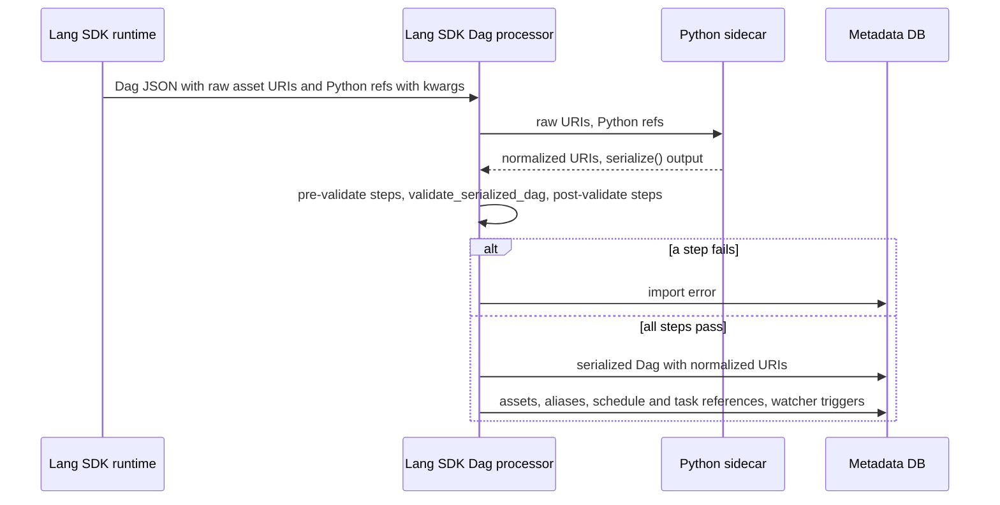
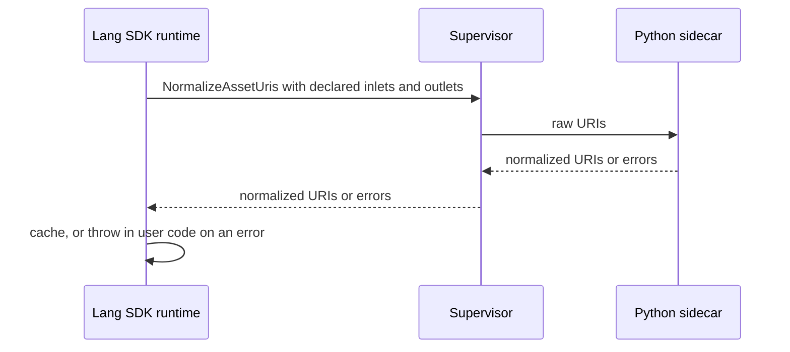
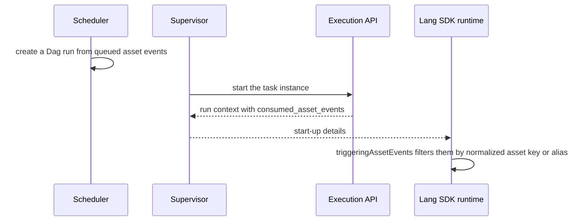
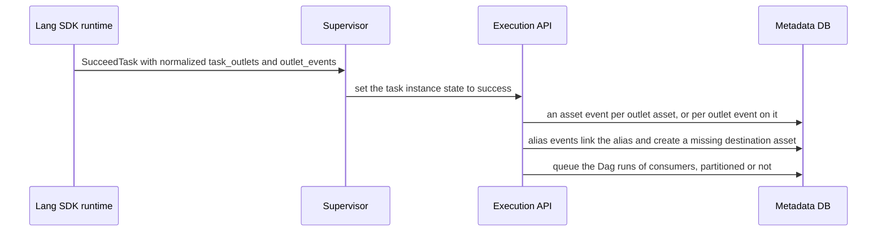
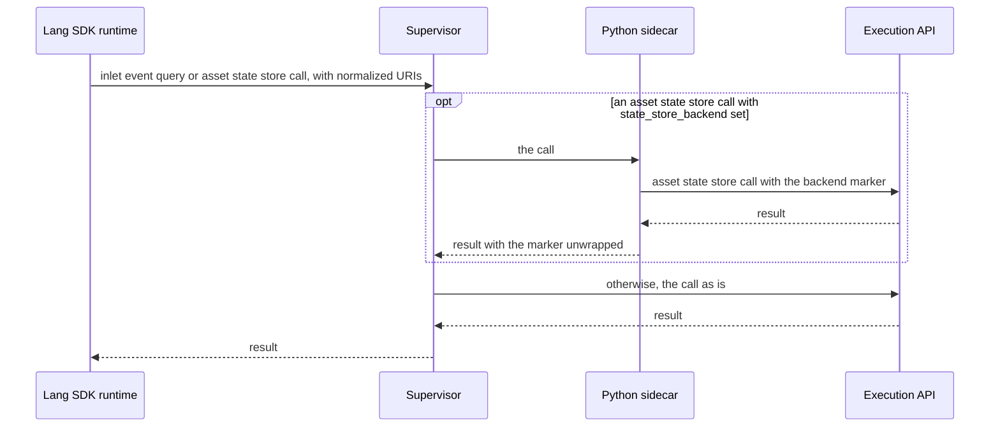

<!--
 Licensed to the Apache Software Foundation (ASF) under one
 or more contributor license agreements.  See the NOTICE file
 distributed with this work for additional information
 regarding copyright ownership.  The ASF licenses this file
 to you under the Apache License, Version 2.0 (the
 "License"); you may not use this file except in compliance
 with the License.  You may obtain a copy of the License at

   http://www.apache.org/licenses/LICENSE-2.0

 Unless required by applicable law or agreed to in writing,
 software distributed under the License is distributed on an
 "AS IS" BASIS, WITHOUT WARRANTIES OR CONDITIONS OF ANY
 KIND, either express or implied.  See the License for the
 specific language governing permissions and limitations
 under the License.
 -->

# ADR-0019: Assets and Timetables Across Lang SDKs

## Status

Proposed.

## Context

A Lang SDK Dag cannot use assets: it cannot define one, schedule on one, declare inlets or outlets,
or read and emit asset events. Its `schedule` takes only a cron expression or a preset. The runtimes
send `task_outlets: []` and `outlet_events: []` on success, so even a stub TaskHandler behind a
Python `@task.stub` with outlets records no asset event.

This ADR fixes the contract every SDK shares. Each SDK records its own spelling in its own ADR:
[TypeScript](../../../ts-sdk/adr/0004-assets-and-timetables-authoring-interface.md),
[Go](../../../go-sdk/adr/0010-assets-and-timetables-authoring-interface.md) and
[Java](../../../java-sdk/adr/0004-assets-and-timetables-authoring-interface.md).

## Decision

1. **No new stored format.** Assets, refs, aliases and `all`/`any` conditions use
   `encode_asset_like`. Timetables and partition mappers are stored as
   `{"__type": <import path>, "__var": <the class's serialize() output>}`. Asset watcher triggers use
   `{"classpath": <import path>, "kwargs": {...}, "queue": <optional>}`.
2. **What every SDK can author**: `Asset` (name and/or URI, group, extra, watchers, access
   control), `AssetRef` by name or by URI, `AssetAlias`, `AssetWatcher`, `all`/`any` conditions,
   and task `inlets` and `outlets`.
3. **A Lang SDK runtime sends `task_outlets` as a Python task does**, built from its own task
   definitions, aliases included, beside `outlet_events`, with normalized URIs (decision 5). The
   Execution API does not change. A stub TaskHandler sends no outlets for now, so it records no
   asset event: its outlets are declared on the Python `@task.stub`, and the run context does not
   carry them to the runtime. A run-context field can add them later.
4. **The Dag processor validates; each SDK validates on a best-effort basis at build time.** The
   Lang SDK Dag processor runs a registered list of post-parse steps on each Dag a runtime returns.
   Each step is a small object with one method. Steps that fix the raw Dag run before
   `validate_serialized_dag` and steps that need the deserialized Dag run after it:

   ```python
   class PostParseStep(Protocol):
       def apply(self, data: dict[str, Any], dag: SerializedDAG | None, ctx: PostParseContext) -> None: ...


   PRE_VALIDATE_STEPS = [FillConfigDefaults(), NormalizeAssets(), FillBatchAssetEvents(), BuildPythonRefs()]
   POST_VALIDATE_STEPS = [ApplyTeamRules(), NormalizeLoops(), DeriveDagDependencies()]
   ```

   `NormalizeAssets` runs the checks Python's `Asset` runs, including `_sanitize_uri` with the URI
   handlers providers register, and writes the normalized URI back. A URI-only asset gets the raw
   URI as its name before the URI is normalized, as in Python, so the same asset defined in Python
   and in a Lang SDK gets the same key. `FillBatchAssetEvents` fills Python's default when an SDK
   leaves `batch_asset_events` unset. `DeriveDagDependencies` derives the asset `dag_dependencies`
   with the existing dependency detectors on the deserialized Dag. Any error becomes an import
   error. Provider and plugin code runs only in a Python sidecar process (decision 5) that the
   steps reach through `ctx`, not in the Dag processor manager. The stored Dag, the UI and
   `dag_dependencies` show the normalized URI. An SDK checks a subset that needs no Python, such as
   a non-empty name or URI, a scheme other than `airflow`, a JSON `extra` and cron syntax.
5. **The runtime normalizes every URI it uses, through the Python sidecar.** A runtime holds the raw
   URI and cannot run `_sanitize_uri`, so it sends a new supervisor message,
   `NormalizeAssetUris`. The supervisor passes it to the per-task Python sidecar process, the
   process that runs the XCom backend today (`coordinators/_xcom_backend.py`), and returns each
   normalized URI or an error. The runtime sends it on its first asset access for every declared
   inlet and outlet in one batch, and again for a URI built at run time. It caches each result,
   then keys triggering events, outlet events, `task_outlets`, inlet event queries and asset state
   store calls on the normalized URI. Provider code runs in neither the supervisor nor the API
   server. An error throws in user code, so the task fails and retries apply, as in Python. A
   sidecar crash or timeout fails the task the same way.
6. **Python references keep the existing envelopes for now.** Each SDK has a `python` module with
   `timetableRef(path, kwargs)`, `partitionMapperRef(path, kwargs)` and `triggerRef(path, kwargs)`.
   `kwargs` are constructor arguments, sent as `encode_trigger` writes them: scalars and arrays pass
   through, and the SDK wraps an object and a typed value in their `BaseSerialization` tags. A
   timetable or mapper ref is sent as `{"__type": <import path>, "__kwargs": {...}}`.
   `BuildPythonRefs` constructs the class in the Python sidecar at parse time and replaces it with
   the stored envelope of decision 1, so a plugin's `serialize()` format stays private to the
   plugin and the stored format does not change. Future Python references, such as callbacks and retry
   policies, go in the same module.
7. **Every built-in timetable and partition mapper has a typed builder** in each SDK, which writes
   the stored envelope directly. They cover `BUILTIN_TIMETABLES` and `BUILTIN_PARTITION_MAPPERS` in
   `airflow/serialization/encoders.py`, plus the windows and wait policies a rollup or fan-out mapper
   takes. Builder parameters follow the Python constructors, including which are required, such as
   the timezone of a cron timetable. CI generates golden JSON from Python's encoders for each
   built-in. Each SDK's conformance tests check that its builders produce the same JSON, and that
   `decode_timetable` or `decode_partition_mapper` reads it back. A CI test also checks that each
   builder covers every constructor parameter. A duration is sent as seconds.
   `decode_run_immediately` accepts an integer as well as a float, so an SDK does not need to force
   a float.
8. **`schedule` is widened in place.** Cron expressions and presets keep their current meaning, and
   a timetable is now accepted too. Durations are seconds and datetimes carry an offset. Calendar
   durations (`relativedelta`) are out of scope; use `timetableRef`.
9. **Accessors take an asset or a ref**, so a stub TaskHandler can name an asset by `name` or `uri`.
   Outlet events and triggering events are on the task context, since they are local. Triggering
   events come from `consumed_asset_events` in the start-up details, so they have no `id` or asset
   `group` and add the source alias names; each SDK gives them their own type. Inlet events and the asset
   state store (`get`, `set`, `delete`, `clear`) are on the client, since each call is a round trip.
   The asset state store takes an asset or a ref, not an alias, since its messages address an asset
   by name or URI only. When `[workers] state_store_backend` is set, the supervisor runs asset state
   store calls through the Python sidecar, which applies the backend as Python does: `set` stores
   the backend's marker, `get` unwraps it and `delete` and `clear` remove the backend object.
10. **Inlet events take the same filters as Python**: `after` (`>=`), `before` (`<=`),
   `ascending` (default true), `limit`, exact partition key, partition key pattern, and `extra`
   key/value pairs that must all match, as `GetAssetEventByAsset` and `GetAssetEventByAssetAlias`
   define them. Each SDK names its parameter type `InletEventQueryParams` and adds `first()` and
   `last()`, which send `limit: 1` in ascending or descending order. Asking for inlet events on an
   asset that is not among the task's inlets throws, as Python raises `KeyError`.
11. **Outlet events serialize as
    [`_serialize_outlet_events`](https://github.com/apache/airflow/blob/76c71156732a1bb39c7e67bf4d4fd5a756953bd3/task-sdk/src/airflow/sdk/execution_time/task_runner.py#L1516)
    does.** `extra` is a JSON object. A
    partition key is a non-blank string of at most 250 characters, and is rejected on an alias, as
    in Python. An alias event names a destination asset or ref and its `extra`; it registers only
    when the alias is among the task's outlets. On `add()` the runtime resolves the destination: it
    normalizes a URI (decision 5), and fetches a ref with the existing `GetAssetByName` or
    `GetAssetByUri` message, since the event needs the asset's name, URI and `extra`. A missing
    asset throws, as in Python. Three cases throw: an alias event on a non-alias accessor, an outlet
    event for an asset that is not among the task's outlets, and any outlet event from a stub
    TaskHandler. Python drops these events silently today. A separate Python change makes them
    raise, and the SDKs land after it.
12. **Not supported for now**: an `@asset`-style asset-producing Dag, outlets on a stub
    TaskHandler, and a trigger written in a Lang SDK. An asset watcher takes a `triggerRef` only.

## Flows

Parsing a Lang SDK Dag. The asset rows come from the existing `AssetModelOperation`.



URI normalization at run time. Every later flow uses the cached normalized URIs.



Task start. Triggering events need no core change.



Task success. Everything after the runtime is the Python task path, unchanged.



Inlet event queries and asset state store calls.



Asset watchers and asset-triggered scheduling run as they do for a Python Dag, from the rows the
parsing flow writes.

## Consequences

- No scheduler, triggerer or Execution API change. The core changes are:
  - the supervisor: the `NormalizeAssetUris` handler and the asset state store backend path, both
    through the Python sidecar process, which must land first;
  - the Lang SDK Dag processor: the registered post-parse steps, a Python sidecar per parse, and
    the existing detectors accepting a deserialized Dag;
  - `decode_run_immediately` accepting an integer;
  - the golden fixtures and their decode check.
- The XCom backend process becomes a Python sidecar process. It runs every partial Python step of
  a Lang SDK task or parse that involves user code or provider code, starting with the XCom
  backend, URI normalization and Python refs.
- Each SDK gains a `python` module as a public interface for referring to objects on the Python
  side. It is the escape hatch for timetables, partition mappers and triggers from providers and
  plugins that have no typed builder.
- A new Lang SDK post-parse feature adds a step to a list instead of editing the Dag processor.
- Each new built-in timetable or mapper needs a builder in each SDK; the golden fixtures fail CI
  until it has one.
- A worker needs the same providers as the Dag processor to normalize a URI the same way, as a
  Python task already does.
