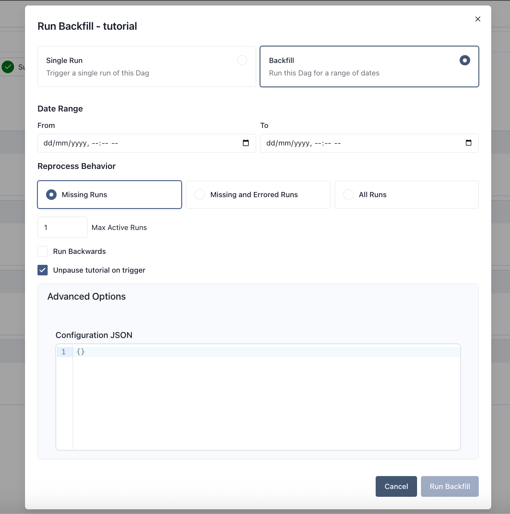

 .. Licensed to the Apache Software Foundation (ASF) under one
    or more contributor license agreements.  See the NOTICE file
    distributed with this work for additional information
    regarding copyright ownership.  The ASF licenses this file
    to you under the Apache License, Version 2.0 (the
    "License"); you may not use this file except in compliance
    with the License.  You may obtain a copy of the License at

 ..   http://www.apache.org/licenses/LICENSE-2.0

 .. Unless required by applicable law or agreed to in writing,
    software distributed under the License is distributed on an
    "AS IS" BASIS, WITHOUT WARRANTIES OR CONDITIONS OF ANY
    KIND, either express or implied.  See the License for the
    specific language governing permissions and limitations
    under the License.

Backfill
========

Backfill is when you create runs for past dates of a Dag. Airflow provides a mechanism
to do this through the CLI and REST API. You provide a Dag, a start date, and an end date,
and Airflow will create runs in the range according to the Dag's schedule.

Backfill does not make sense for Dags that don't have a time-based schedule.

Control over data reprocessing
------------------------------

There are three options for reprocessing behavior. The user-facing names and their corresponding
CLI and REST API values are:

* **Missing Runs** (``none``) - if there's already a run for this logical date, do not create another,
  no matter the state
* **Missing and Errored Runs** (``failed``) - if a run exists and is failed, create a new run for this date
* **All Runs** (``completed``) - if a run exists and is completed or failed, create a new run for this date

If the latest run is still running or is queued, we do not create another run, no matter the chosen reprocessing behavior.

Concurrency control
-------------------

You can set ``max_active_runs`` on a backfill and it will control how many Dag runs in
the backfill can run concurrently. Backfill ``max_active_runs`` is applied independently of
the Dag ``max_active_runs`` setting.

Once a backfill's Dag runs are actually running, the scheduler does not otherwise
deprioritize their task scheduling relative to other running Dag runs. ``max_active_runs``
is therefore the primary lever for controlling how much of your scheduling capacity a
backfill consumes at once — lower it to leave more room for time-sensitive scheduled work
while the backfill is in progress.

.. _backfill:run-timeout:

Run timeouts
------------

Set ``dag_run_timeout`` when creating a backfill to override the Dag's default timeout for each new run.
The limit applies separately to each run, starting when that run enters the ``running`` state.
It does not limit the duration of the whole backfill. See :ref:`dag-run:timeout` for timeout behavior.

The REST API accepts an ISO 8601 duration in requests to ``POST /api/v2/backfills``. For example:

.. code-block:: json

    {
      "dag_id": "tutorial",
      "from_date": "2015-06-01T00:00:00Z",
      "to_date": "2015-06-07T00:00:00Z",
      "dag_run_timeout": "PT30M"
    }

Use ``--dag-run-timeout 1800`` with ``airflow backfill create`` for the same 30-minute limit.
In the UI backfill form, enter a positive number of seconds under **Dag Run Timeout**.
Omit the option, use ``null`` in the API, or leave the UI field empty to inherit the Dag's timeout.

The override applies only to newly created runs. If reprocessing clears and reuses an existing run,
that run keeps its previous override or inherited default.

Run ordering
------------

You can run your backfill in reverse, i.e. latest runs first. The CLI option is ``--run-backwards``.

Dry run
-------

Backfill dry run is a CLI option that will print out the dates that the
backfill will consider creating runs for. Whether or not they will be created
depends on your chosen reprocessing behavior and the states of any existing
runs in the range at the time you actually run the backfill.

Example
-------

Backfill can be created from either the CLI or the UI.

For CLI, below is an example command:

.. code-block:: bash

    airflow backfill create --dag-id tutorial \
        --from-date 2015-06-01 \
        --to-date 2015-06-07 \
        --reprocess-behavior failed \
        --max-active-runs 3 \
        --run-backwards \
        --dag-run-conf '{"my": "param"}'

For UI, follow the following steps:

1. Navigate to a Dag's Details page and click **Trigger**.
2. In the pop-up window, select **Backfill**.
3. Fill in the form:

   - **Date range**: set "From" and "To" logical datetimes for the backfill window.
   - **Reprocess behavior**: choose one of ``Missing Runs``, ``Missing and Errored Runs``, or ``All Runs``.
   - **Max active runs**: limit concurrent backfill runs for this backfill.
   - **Dag Run Timeout**: optionally set the runtime limit in seconds for each new run.
   - **Run backwards**: execute most recent intervals first.
   - **Advanced Config**: optionally provide JSON ``dag_run.conf``.
   - If the Dag is paused, choose under **Dag is paused** what happens to the Dag: **Unpause** (the
     default) makes the Dag active and resumes its schedule; **Drain** lets the unfinished Dag runs,
     including the backfill's, start or resume without creating scheduled ones, and pauses the Dag again once
     they finish (see :ref:`concepts:dag-pausing`); **Keep paused** leaves the backfill runs queued until the
     Dag is unpaused. Both **Unpause** and **Drain** show how many unfinished Dag runs will start or resume.
     Paused backfills remain paused under all three choices.

Partitioned Dag backfills
-------------------------

For Dags that use a partition-based timetable (e.g. ``CronPartitionTimetable``),
the same ``--from-date`` / ``--to-date`` flags are used for all backfills.
Airflow automatically detects whether the Dag is partitioned and interprets
the date range as a partition-date range accordingly — one Dag run is created
per partition within the window.

Example: backfill the partitions from 2026-02-18 to 2026-02-20::

    airflow backfill create --dag-id my_partitioned_dag \
        --from-date 2026-02-18 \
        --to-date 2026-02-20

Concurrency is controlled by the same ``--max-active-runs`` option used for
all backfills.
