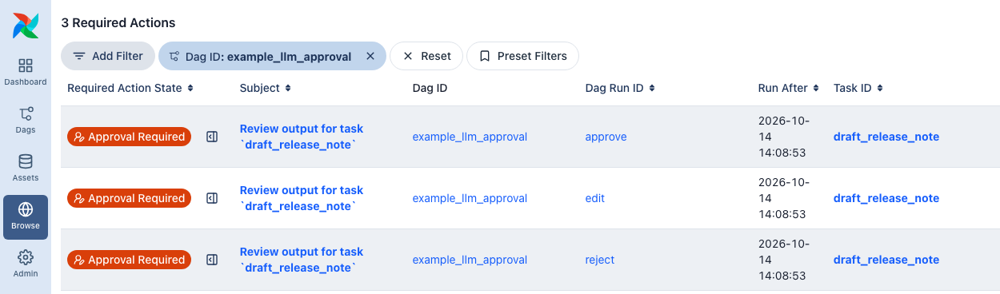
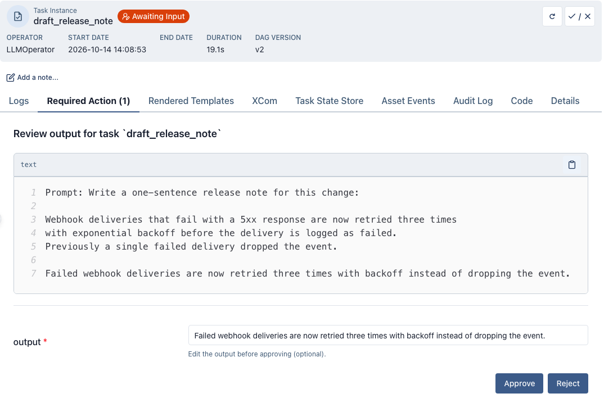

 .. Licensed to the Apache Software Foundation (ASF) under one
    or more contributor license agreements.  See the NOTICE file
    distributed with this work for additional information
    regarding copyright ownership.  The ASF licenses this file
    to you under the Apache License, Version 2.0 (the
    "License"); you may not use this file except in compliance
    with the License.  You may obtain a copy of the License at

 ..   http://www.apache.org/licenses/LICENSE-2.0

 .. Unless required by applicable law or agreed to in writing,
    software distributed under the License is distributed on an
    "AS IS" BASIS, WITHOUT WARRANTIES OR CONDITIONS OF ANY
    KIND, either express or implied.  See the License for the
    specific language governing permissions and limitations
    under the License.

.. _approval-gates:

Approval gates for LLM operators
================================

.. seealso::
    For a multi-round review loop on ``AgentOperator`` with a chat UI and REST API, see
    :doc:`hitl_review`.

Set ``require_approval=True`` and the task stops after the model answers. A person
reads the output in the Airflow UI and approves it, edits it, or rejects it, and only an
approved answer reaches the tasks downstream. To review each tool call an agent makes
rather than its final answer, see :doc:`tool_approval`.

Approval gates need Airflow 3.1 or later. On an older Airflow version the operator
raises ``AirflowOptionalProviderFeatureException: require_approval=True needs Airflow 3.1+.``
when it is constructed, so the Dag file fails to import, and with it every Dag
defined in that file. A dynamically mapped
task (``.expand()``) is only constructed when it runs, so there the same error
surfaces as a task failure, before the model is called.

A Dag with an approval gate
---------------------------

``draft_release_note`` asks the model for a release note and waits for a reviewer.
``publish`` runs only after the note is approved, and receives the approved text,
including any edit the reviewer made:

.. exampleinclude:: /../../ai/src/airflow/providers/common/ai/example_dags/example_llm_approval.py
    :language: python
    :start-after: [START howto_operator_llm_approval_walkthrough]
    :end-before: [END howto_operator_llm_approval_walkthrough]

The Dag runs as-is once the ``pydanticai_default`` connection points at a model; see
:doc:`connections/pydantic_ai`.

Where the review appears
------------------------

Once the model has answered, ``draft_release_note`` writes its review request and pauses.
On Airflow 3.3 and later the task is in the ``awaiting_input`` state and holds no worker
slot. The last line of its log, inside the **Post Execute** group that the log view
shows collapsed, is:

.. code-block:: text

    Pausing task as AWAITING_INPUT.

On Airflow 3.1 and 3.2 the task is ``deferred`` instead, and the triggerer watches for the
answer, so a triggerer must be running.

Every review is listed under **Browse > Required Actions**. An open one carries the
**Approval Required** badge; once answered, the row stays and the badge changes to
**Approval Received** or **Rejection Received**:

The subject links to the review. The task instance page opens it too: the task shows the
**Awaiting Input** badge, and its **Required Action (1)** tab holds the form.

What the reviewer sees
----------------------

The form shows:

* The subject, :literal:`Review output for task \`draft_release_note\`` by default.
* The body: the rendered prompt, then the model's output. The system prompt is not shown.
* An ``output`` field holding the model's output, which the reviewer can change before
  approving. It is there because the Dag sets ``allow_modifications=True``; without it the
  form has only the two buttons.
* **Approve** and **Reject**.

After the reviewer clicks a button, the form is disabled and shows
``Response received at <time> from <user>``, and the task resumes on a worker to apply
the answer.

What each answer does
---------------------

Each row comes from a run of the Dag above, answered by the user ``admin``, against a
stand-in model that always returns the same sentence; your model's wording will differ.
The timeout rows set ``approval_timeout=timedelta(minutes=1)`` and the
``on_approval_timeout`` value shown. An exception appears in the log under
``Task failed with exception``.

.. list-table::
    :header-rows: 1

    * - Answer
      - Result
      - ``draft_release_note`` log after it resumes
    * - Approve
      - ``draft_release_note`` succeeds; ``publish`` runs with the model's output.
      - ``Output approved by admin.``
    * - Edit the ``output`` field, then Approve
      - ``draft_release_note`` succeeds; ``publish`` runs with the edited text.
      - ``Output approved by admin.``, then ``output=<edited text> modified by the
        reviewer=admin``
    * - Reject
      - ``draft_release_note`` fails; ``publish`` is upstream_failed.
      - ``HITLRejectException: Output was rejected by the reviewer admin.``
    * - No answer before ``approval_timeout``, with ``on_approval_timeout="fail"`` (the
        default)
      - ``draft_release_note`` fails; ``publish`` is upstream_failed.
      - ``HITLTimeoutError: Approval timed out: The Human-in-the-loop response timeout has
        passed without a response.``
    * - No answer, with ``on_approval_timeout="approve"``
      - ``draft_release_note`` succeeds; ``publish`` runs with the model's output.
      - ``Output approved by the approval timeout default.``
    * - No answer, with ``on_approval_timeout="reject"``
      - ``draft_release_note`` fails; ``publish`` is upstream_failed.
      - ``HITLRejectException: Output was rejected automatically: approval_timeout expired
        with on_approval_timeout='reject'.``

After an approval, ``publish`` logs the text it received. For the plain approval:

.. code-block:: text

    Publishing release note: Failed webhook deliveries are now retried three times with backoff instead of dropping the event.

For the edited one:

.. code-block:: text

    Publishing release note: Webhook deliveries that fail with a 5xx response are now retried three times with exponential backoff.

The approved text is the task's ``return_value`` XCom, which is what ``draft.output``
passes to ``publish``.

A rejection, or a timeout with ``"fail"`` or ``"reject"``, fails the task like any other
exception, so ``retries`` apply: with a retry left, the task goes to ``up_for_retry``, and
the retry calls the model again and opens the review again, unanswered. On Airflow 3.4
and later the reopened review shows the new subject, body and output. On Airflow 3.1 to
3.3 it keeps the first attempt's subject, body and ``output`` field, so the form shows the
earlier output: with ``allow_modifications=True``, Approve returns that earlier text
unless the reviewer edits it; without it, Approve returns the regenerated output, which
the reviewer did not see. With ``retries=0``, the default, a rejection is final.

With ``fail_on_reject=False``, a rejection, including a timeout with ``"reject"``, succeeds
the task instead and **skips the direct downstream tasks except teardowns**, matching
:class:`~airflow.providers.standard.operators.hitl.ApprovalOperator`. Set
``ignore_downstream_trigger_rules=True`` to skip every downstream task rather than only the
direct ones. A timeout with ``"fail"`` still fails the task.

Editing structured output
-------------------------

On ``LLMOperator``, ``LLMFileAnalysisOperator`` and ``LLMSchemaCompareOperator``, the edited text is
converted back into ``output_type`` when the task resumes.  Write it as JSON for the
type, such as ``31`` for an ``int``, ``["a", "b"]`` for a ``list[str]`` or an object for
a Pydantic model.  If the edit field shows ``[object Object]`` for an object output,
replace its content with the JSON shown in the review body.  Types that pydantic builds
from a string, such as a ``Literal``, an ``Enum`` or ``str | None``, also accept the bare text.  If the text does not validate,
the task fails with
:class:`~airflow.providers.common.ai.exceptions.ReviewedOutputValidationError`
naming the type and the (truncated) text received, rather than passing a value of the wrong
type downstream.  Airflow retries it like any other failure, so with ``retries`` set the
next try runs the model again and the rejected edit is not carried over.

With ``output_type=str`` any edit is accepted as is, and so is an edit to a union with a ``str``
member, such as ``Model | str``, which keeps the text when it does not validate as the model.
An output function, a pydantic-ai
output marker such as ``ToolOutput``, or a type pydantic has no schema for, is returned as
the text unchanged.  An approval without an
edit whose output cannot be converted back (for example a custom serializer) also returns
the text with a warning, instead of failing the task.  Computed fields are left out of the
text.  A model with a serializer that cannot be reversed, or a required field excluded from
the dump, shows text that does not validate as shown, so write an edit in the form the model
accepts.

Timeouts
--------

``approval_timeout`` bounds the wait; the default ``None`` waits indefinitely. On Airflow
3.3 and later the scheduler resolves expired reviews, checking every
``[scheduler] trigger_timeout_check_interval`` seconds (15 by default), so a review can
stay open that long past its deadline. On Airflow 3.1 and 3.2 the triggerer enforces the
deadline. ``on_approval_timeout="approve"`` returns the generated output when the
timeout expires. ``"reject"`` answers the review with a rejection, which fails the task
unless ``fail_on_reject=False``. The chosen option is also pre-highlighted as the
default in the review form, so ``"reject"`` makes Reject the primary button.

This example approves the output if nobody answers within 24 hours, and logs each new
review through a notifier:

.. exampleinclude:: /../../ai/src/airflow/providers/common/ai/example_dags/example_llm.py
    :language: python
    :start-after: [START howto_operator_llm_approval]
    :end-before: [END howto_operator_llm_approval]

It runs as-is with the same ``pydanticai_default`` connection.

Notifying reviewers
-------------------

Airflow sends no notification when a review opens.  Pass
``approval_notifiers`` to tell the reviewers about it through any Airflow
notifier (Slack, email, ...), the way
:class:`~airflow.providers.standard.operators.hitl.HITLOperator` does with
``notifiers``.  The notifiers run once the review is open and can reference
the review ``{{ task.subject }}`` and ``{{ task.body }}`` in their templates,
as the example under `Timeouts`_ does: its notifier writes the subject and body to the
task log, just before ``Pausing task as AWAITING_INPUT.``  The ``@task.llm`` decorator
and the ``LLMOperator`` subclasses (``LLMBranchOperator``, ``LLMSQLQueryOperator``,
``LLMSchemaCompareOperator``, ``LLMFileAnalysisOperator``) accept the same
parameter.  A notifier that raises is logged as
``Approval notifier <notifier> failed; the review stays open`` and the task still
waits for the review.  A Jinja ``TemplateError`` in a notifier's template fails the
task.  A retry re-runs the LLM and re-notifies with the regenerated output.  What the
reopened review shows depends on the Airflow version, as described under
`What each answer does`_.

The default ``body`` contains the rendered prompt and the output.  Where either
is sensitive, template only ``{{ task.subject }}`` and a link to the review
into channels outside Airflow's auth boundary.

Restricting who can review
--------------------------

By default any user allowed to edit the Dag's Human-in-the-loop details can answer the
review; under the FAB auth manager that is the ``can edit on HITL Detail`` permission,
which the User role and every role above it have.  Pass
``approval_assigned_users=[{"id": "<auth-manager-user-id>", "name": "<user-name>"}]``
to restrict it to named reviewers, the way
:class:`~airflow.providers.standard.operators.hitl.HITLOperator` does with
``assigned_users``.  ``id`` is the user id reported by the auth manager: with
the default ``SimpleAuthManager`` it is the username from
``simple_auth_manager_users``; under the FAB auth manager it is the numeric
user row id as a string, not the username.  On Airflow 3.1.0 through 3.1.5 both
``id`` and ``name`` must match what the auth manager reports, so a wrong
``name`` blocks the assigned reviewer as well as everyone else; from 3.1.6 only
``id`` is compared.  On Airflow 3.4 and later a cleared or retried task replaces the
list along with the rest of the review.  On Airflow 3.1 to 3.3 the list is stored when the
review is first created, so if you edit ``approval_assigned_users`` and clear the task,
the old list still applies.

.. _approval-gates:uncertain:

Reviewing uncertain output
--------------------------

.. note::

    Experimental: this can change or be removed in a minor release of this provider.
    See :ref:`howto/stability`.

A decision model reports a confidence for every field of a structured output, in
``provider_details`` on the model response. It is a
summary of how concentrated the model's probability distribution was, not the
probability that the field is right. ``decision_policy=DecisionPolicy(min_confidence=0.7)``
(import ``DecisionPolicy`` from ``airflow.providers.common.ai.operators.llm``)
is the bar the least confident field has to clear for the operator to return
the output by itself. Only fields that reported a confidence are compared: a
field whose type reports none (a bounded float, where the probability is the
answer) is not gated, and the record's ``confidence`` map shows which fields
were. Under the bar, the policy's ``on_uncertain`` applies: ``"review"``
(default) sends the output to human review through the same approval flow as
``require_approval``, with the same ``approval_timeout``,
``on_approval_timeout`` and notifier settings; ``"fail"`` fails the task with
``LowConfidenceError`` (from ``airflow.providers.common.ai.exceptions``), which
Airflow retries like any other failure unless a retry rule says otherwise. A
text model reports no confidence for any field, which counts as uncertain, so
switching the connection does not silently switch off a control you set.
``require_approval=True`` keeps its meaning and always asks, and
``on_uncertain="review"`` needs Airflow 3.1+ like it does. The policy is
honoured by ``LLMOperator`` and ``LLMBranchOperator``; the SQL, schema-compare
and file-analysis operators run their own ``execute`` and reject a policy with a
bar at construction.

With or without a bar, the operator pushes a ``decision`` XCom carrying the
model name, the per-field ``confidence`` and ``probabilities`` (empty for a text
model), the bar that applied, why the output went to review if it did, who
decided, and the gate configuration in force.
A pending record is checkpointed with the paused task and finalized from that
copy on resume, not from the XCom. See :ref:`LLMBranchOperator <howto/operator:llm_branch>` for the
record's fields; there ``proposed`` and ``action`` name the branches, while
here they are ``null`` and the output itself is the return value.
